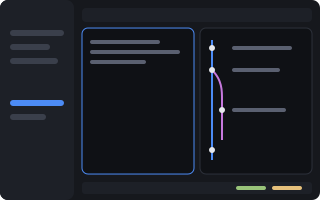

# Herdr Workstation

One command turns [Herdr desktop](https://herdr.dev) into a full agent workstation: review your
agent's changes and send comments back to it, a git graph, live Markdown
preview, a Dock badge and system notifications when an agent needs you, and Claude Code / Codex usage
limits in the status bar.



## Install

```sh
curl -fsSL https://raw.githubusercontent.com/mayurdluffy/herdr-workstation/main/install.sh | bash
```

Needs Herdr desktop (started once), `git`, `curl` and `python3`. macOS or Linux.
Run the same command again to update. Options (after `bash -s --`):

| Option | Skips |
|---|---|
| `--no-switch` | switching to the Workstation layout at the end |

Uninstall: `bash ~/.local/share/herdr-workstation/uninstall.sh` (it also clears our `ws.*` shared state).

## What you get

The tab bar has four panels: **Files**, **Changes**, **Graph** and **Comments**
(our Changes, with Accept/Reject, replaces Herdr's own). Each remembers, per space, whether it was open.

### Comment on anything, send it as one message

Select something, press **Comment**, write a note. It waits in the **Comments** panel (the tab bar
shows how many) until you **Send all**: the agent gets one message with each comment's file and lines
(or commit, terminal), the quoted text and your note, like Claude Code desktop or T3. Send one
comment straight away with **Send now**, or **Copy** them instead. **Edit** changes a comment's note.

An agent that is working, or waiting on a question, isn't typed into: its comments are **queued**
and go by themselves when it stops (the status bar shows how many wait; **Send now** sends anyway).
If an agent's terminal is gone, **Move to…** gives its comments to another agent.

| Where | How |
|---|---|
| **Files** | open a file, select code (or put the cursor on a line), **Comment**. Markdown opens as a rendered **Preview** (switch to **Code**); select in it and Comment |
| **Changes** | click a diff line, shift-click another, **Comment** |
| **Graph** | click a commit; **Comment** on it, or select diff lines first |
| **Terminals** | select text: the pane header shows **Comment** (or `cmd-shift-m`) |
| **Markdown preview pane** | select text, **Comment** |

### Panels

- **Changes**: Source Control, as VS Code has it. The top has a commit message (`⌘Enter` commits), **Commit** (when there's nothing to commit it becomes **Sync Changes** or **Publish Branch**) with a drop-down (Amend, Commit & Push, Commit & Sync), the branch (click it to check out another) with ↓/↑ Sync, and **⋯**: View & Sort (list or tree; by name, path or status), Pull, Push, Clone, Checkout to, Fetch, and the Commit, Changes, Pull/Push, Branch, Remote, Stash and Tags submenus, plus **Show Git Output** (every command it ran, with its output). The file list shows the agent's uncommitted changes. **Accept** stages a file or a hunk, **Reject** restores it (a new file is deleted after a second click). Accepted files wait under Accepted until you commit.
- Diffs show the **Whole file** with its changes in place, as VS Code does (or only the hunks), wrap
  long lines, mark the changed words in a changed line, show **Inline** or **Side by side**, and
  **Show all** past 2,000 lines. **Accept hunk** / **Reject hunk** still act on just that hunk.
- **Graph**: every branch's commits with refs; click one for its diff, **Review** it in plannotator.
  **Find** narrows it to commits by message, author, hash or branch. The checked-out branch has a ✓,
  and a branch and its remote twin on the same commit are one badge (`main ☁ origin`). It redraws when
  the repository's refs change.
- **Files**: Herdr's Files, plus Comment, Markdown Preview, **Annotate** (plannotator) and **Open beside** (a live preview pane).
- **Sidebar**: one list. Each space has its own little blob character in its color. Its chevron shows its tabs, each with its agent, how long since it changed, and its state (working, needs you, done, idle); click one to go there. A folded space still shows its most urgent state. There's no separate Agents list. Add machine is the machine icon beside the Spaces +.
- **Activity** (status bar): the Dock badge counts agents that need you or finished while you weren't
  looking; **Next** goes to the one that needs you most. While Herdr isn't in front, an agent that needs
  you or finishes posts a system notification; the bell turns those off (Herdr's own sounds and toasts
  are in Settings > Alerts).
- **Usage**: the status bar's right half is [usage-limits](https://github.com/VladTemp27/herdr-mods): Claude Code and Codex 5-hour and weekly limits, reset times and plan. It asks the `claude` and `codex` CLIs themselves and never reads a token.

### Keys

| Key (macOS / Linux) | Does |
|---|---|
| `cmd-p` | Go to… (the sidebar's search too): spaces with their blobs, tabs by their agent's title and state |
| `cmd-shift-k` / `ctrl-alt-k` | Workstation menu: review, last reply, docs, approve a plan, graph, Markdown, comments, usage, notifications |
| `cmd-shift-m` / `ctrl-alt-m` | Comment on the terminal selection |
| `cmd-shift-g` / `ctrl-alt-g` | Git graph as a pane beside the focused one |
| Ctrl/Cmd-click a `.md` path | Live Markdown preview beside that pane |

## How it installs

Everything goes into Herdr's home (`~/.config/herdr-app`, or `$HERDR_APP_HOME`):

- `layouts/workstation.json`: Herdr's main layout plus the usage bar and the Markdown link handler.
- `mods/ws-*`: this repo's mods. `ws-tabs`, `ws-files`, `ws-pane`, `ws-spaces`, `ws-picker` and `ws-chrome` are copies of Herdr's `tabs`, `files`, `pane`, `spaces`, `picker` and `workspace-chrome` with our additions marked `WS:`; they don't pick up Herdr's later changes to those mods by themselves. The installer warns when Herdr has changed one since (see Develop).
- `mods/usage-limits`: third-party, pinned in [`vendor.lock`](vendor.lock).
- `keys.json`: our keys are added only where the key is free; yours are never replaced. `cmd-p` moves to our Go to… only while it still opens Herdr's own picker, and goes back on uninstall.

A mod folder is only replaced when it carries our `.herdr-workstation` marker, so a mod of yours
with the same name is left alone. Each mod passes `herdr-app check` before the install reports success.
Tools: `plannotator-tui` (Homebrew, else cargo).

## Develop

Edit a mod in `mods/` (shared code lives in `lib/` and is copied into the mods that use it by `scripts/sync-lib.sh`), run `./install.sh` (it installs from the checkout it's in), and
Herdr reloads it live. Before a commit, `scripts/check.sh` must pass: lib copies in sync, `npm test`
(Node 22.15+; `test/register.js` stands in for Herdr's modules), and `herdr-app check` on every mod. CI runs the first two.

When Herdr updates its own mods, `scripts/forks.sh` says which of our copies are behind and
`scripts/forks.sh merge` merges Herdr's changes into them (three-way, against the base kept in
`upstream/`); resolve any conflicts it marks, then check and install. To bump a third-party pin, read its
diff first, then change the ref in `vendor.lock`.

## Credits

[usage-limits](https://github.com/VladTemp27/herdr-mods) (Apache-2.0, VladTemp27),
[plannotator-tui](https://github.com/plannotator/plannotator-tui) (MIT, plannotator). They are
downloaded from their own repositories at install time, with their licenses.
The layout starts from Herdr desktop's shipped `main` layout (Apache-2.0).
